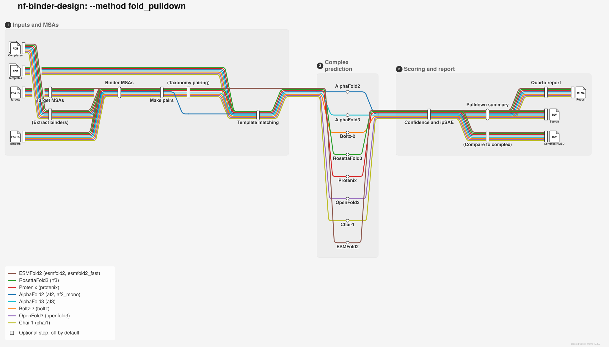

# Fold Pulldown

[](../images/fold_pulldown_metro_map.svg){target="_blank" rel="noopener" title="Open the full-size diagram in a new tab"}

An AlphaPulldown-like target × binder pulldown across the shared fold engines
(AlphaFold2, Boltz-2, RosettaFold3, Protenix, AlphaFold3, OpenFold3, Chai-1,
ESMFold2, ESMFold2-Fast).

!!! info "Previously `--method boltz_pulldown`"

    This workflow began as Boltz Pulldown, which could only co-fold with
    Boltz-2. It has since been expanded to run any of the fold engines above,
    and gained per-chain template matching, multiple samples per pair and a
    cross-engine score summary. `--method boltz_pulldown` has been removed; use
    `--method fold_pulldown --methods boltz` for the equivalent Boltz-only run.

## Overview

For every target–binder pair the pipeline co-folds the complex with each
selected predictor (optionally with multiple seeds / samples per model), then
writes:

| File | Contents |
|------|----------|
| `fold_pulldown/fold_pulldown_scores.tsv` | One row per predicted structure (canonical fold scores + `target`, `binder`) |
| `fold_pulldown/fold_pulldown_summary.tsv` | One row per `(target, binder, tool)` with mean/median/max/sd for `iptm` and `ipsae`, per-target within-tool z-scores, cross-tool `consensus_z`, and the `z_basis` / `n_pool` / `z_pool_small` provenance of that z |
| `fold_pulldown/fold_pulldown_report.html` | Simple Quarto overview (boxplots, heatmaps, top hits, cross-tool Spearman) |

## Setup

Setup is the same as for [Fold](fold.md#setup). Engine containers and their
weights are pulled automatically, except the AlphaFold3 weights
([AlphaFold3 weights](fold.md#alphafold3-weights)). Local sequence databases are
needed only for `--msa_method jackhmmer_af2`, or for `--msa_method mmseqs2_colabfold`
without `--use_remote_server true`. See [Fold databases](../extra/fold-databases.md).

## Example

```bash
nextflow run Australian-Protein-Design-Initiative/nf-binder-design \
  --method fold_pulldown \
  --targets targets.fasta \
  --binders binders.fasta \
  --methods boltz,rf3,protenix \
  --create_target_msa true \
  --msa_method jackhmmer_af2 \
  --n_predictions 5 \
  --outdir results \
  -profile slurm,m3
```

## Multiple sequence alignments

MSA cost is **O(N_targets + N_binders)**, not O(N × M): each sequence is searched
once. Binders are treated as having no useful homologs (query-only MSA unless
`--create_binder_msa` is set). The pipeline never builds a joint paired
alignment; each chain is rendered on its own, and an engine pairs rows only in
the cases below.

FASTA header ids are used as per-chain filenames and are sanitised (non
`[a-zA-Z0-9_.-]` characters become `_`) before use. The pipeline will fail early with a warning is there are duplicate ids within `--targets` or `--binders`, or an id is present in both `--targets` and `--binders` (after sanitisation). Since output complexes are named with `<target>_and_<binder>`, ids that contain `_and_` may be rejected if they would be ambiguous.

### Taxonomic pairing

Pairing is done by the fold engine, from per-chain files, and only when **both**
chains have homologs that share a taxonomy id. For _de novo_ binder 'pulldowns' where we typically don't use a binder MSA (`--create_binder_msa false`), the taxonomy is not used. The pairing process uses the same heuristics as in
[Fold](fold.md#paired-msas-how-each-engine-differs): RF3 `TaxID=` a3m,
Protenix species-mnemonic a3m, Boltz `key,sequence` CSV, and the AF3 /
OpenFold3 / Chai-1 equivalents.

| Condition | Pairing |
|-----------|---------|
| `--create_binder_msa false` (the default) | None. Chain B is the binder sequence alone. Boltz is also given `msa: empty` for chain B, including when `--use_msa_server` is set, so the server does not fetch a binder MSA either. |
| `--create_target_msa false` | None for the MSAs this pipeline builds: chain A is a single sequence too. The exception is Boltz with both `--use_msa_server` and `--create_binder_msa true`, which fetches and pairs both chains itself. |
| Both `--create_target_msa` and `--create_binder_msa`, `--msa_method jackhmmer_af2`, and `boltz`, `rf3`, `protenix`, `af3`, `openfold3`, `chai1` or `esmfold2` | The engine pairs shared taxids. Jackhmmer headers carry `TaxID=` / species mnemonics; each chain is still written independently and the engine matches them. |
| Same flags, but `af2` or `af2_mono` | None. Those engines always write the binder chain query-only, whatever `--create_binder_msa` is. If they are the only selected `--methods`, the binder search is skipped. |
| Both MSAs requested, `--msa_method mmseqs2_colabfold` | None. ColabFold headers carry no taxonomy, so the renders stay unpaired. Boltz with `--use_msa_server` and `--create_binder_msa true` still fetches and pairs its own MSAs. |
| `esmfold2_fast`, or `esmfold2` with `--esmfold2_single_sequence` | None. Those runs fold from sequence alone. |

## Template structures

When a target's structure is known, pass it with `--templates` (a directory or
glob of `.pdb` / `.cif` files, e.g. the target PDBs themselves). Templates are
matched to target chains automatically by sequence; see
[Templates](fold.md#templates). In a pulldown:

- Only the **target** chain is templated by default. `--binder_templates true`
  also matches binder chains against the same files, e.g. when a complex
  structure includes a known binder.
- Boltz constrains templated chains close to their template by default
  (`--boltz_template_force`, 1.0 Å), because the chain structures are known and
  the binding pose is what is being predicted. Pass `--boltz_template_force false`
  to let Boltz depart from them.
- Matching cutoffs are the same as in `--method fold`
  ([Match cutoffs](fold.md#match-cutoffs)): identity and coverage of at least
  0.3, at least 40 aligned residues, and the best 4 templates per chain.
- Every engine except ESMFold2 uses templates, most of them up to 4 per chain
  ([how each engine uses them](fold.md#how-each-engine-uses-them)).

## Command-line options

```bash
nextflow run Australian-Protein-Design-Initiative/nf-binder-design \
  --method fold_pulldown --help
```

### Required

| Flag | Description |
|------|-------------|
| `--targets` | FASTA of target sequences. Optional with `--complex_structures` (see [Supplied complexes](#supplied-complexes)) |
| `--binders` | FASTA of binder sequences, or `--complex_structures` instead |

### Common options

| Flag | Default | Description |
|------|---------|-------------|
| `--methods` | `boltz` | Comma-separated: `af2`, `af2_mono`, `boltz`, `rf3`, `protenix`, `af3`, `openfold3`, `chai1`, `esmfold2`, `esmfold2_fast` (see [Choosing engines](fold.md#choosing-engines); ESMFold2 weights and caveats are covered in [ESMFold2](fold.md#esmfold2)) |
| `--af3_model_dir` | `models/alphafold3` | AlphaFold3 weights directory (`af3` only; see [AlphaFold3 weights](fold.md#alphafold3-weights)) |
| `--af3_paired_msa` / `--af3_templates` / `--af3_run_data_pipeline` | `true` / `inline` / `false` | How AF3 is fed and run. `-profile af3_germinal_parity` sets the combination Germinal uses (pairing off, AF3's own template search, data pipeline on) and needs `--af3_db_dir`; see [Germinal: external folding validation](germinal.md#external-folding-validation) |
| `--msa_method` | `jackhmmer_af2` | `jackhmmer_af2` or `mmseqs2_colabfold` |
| `--create_target_msa` | `false` | Build MSA for each target |
| `--target_msa` | none | An A3M for the target, built elsewhere, used instead of searching for one. Its first record must be the target sequence. Only one target: a run with several stops, since one file cannot describe them all. Not usable with `--create_target_msa` |
| `--create_binder_msa` | `false` | Build MSA for each binder (usually leave off for de novo binders). AF2/`af2_mono` always fold the binder chain query-only regardless of this flag (see `bin/fold/assemble_af2_multimer_msas.py`); if AF2/`af2_mono` are the only selected `--methods`, the pipeline warns and skips building the binder MSA entirely. |
| `--n_predictions` | `5` | Samples per complex per method. Matches the native default of the diffusion engines, and with `--af2_keep_models all` it is what AF2's single run already produces |
| `--skip_engens` | `true` | EnGens is off by default (would emit N × M reports) |
| `--consensus_metric` | `ipsae` | `ipsae` or `iptm`; which metric's per-tool z-scores are averaged into `consensus_z` |
| `--z_stat` | `max` | `max` or `mean`; the per-complex statistic over samples that gets standardised |
| `--z_scope` | `target` | `target` standardises within `(target, tool)`; `global` pools all targets into one distribution |
| `--min_pool` | `10` | Pools containing fewer complexes than this threshold are flagged `z_pool_small` in the summary table |

Every pair is a 2-chain complex, so `af2` and `af2_mono` under
`--msa_method jackhmmer_af2` both need a `uniprot/`-bearing `--af2_db_path`
(default `alphafold_20211129`; the [Fold](fold.md) workflow instead defaults to
`alphafold_20240229`, which is monomer-only). Target MSAs for AF2 are built once
(jackhmmer, or a ColabFold/mmseqs2 a3m converted into AF2's per-chain format)
and combined with the query-only binder chain into one AF2 multimer input per
pair.

Every method-specific flag documented under `--method fold --help` (`--af2_*`,
`--boltz_*`, `--rf3_*`, `--protenix_*`, `--af3_*`, `--openfold3_*`,
`--chai1_*`, `--esmfold2_*`) applies here too: the same engines run per target×binder
pair instead of per input FASTA.

`--af2_keep_models` controls which of AF2's 5 models per run are kept. It defaults
to `all` here, so one AF2 execution yields the 5 structures specified by
`--n_predictions` without additional runs (`--method fold` defaults to `best`).
For `af2_mono`, `best` is typically preferred: without an initial guess, monomer
models frequently fail to dock, and ranking isolates docked poses from failed
predictions.

## Output

Default layout under `--outdir` (`params.json` and `logs/` are written to the outdir
root, alongside `fold_pulldown/`):

```
results/
├── params.json
├── logs/
└── fold_pulldown/
    ├── pairs.tsv                    # id, target, binder (one row per co-folded pair)
    ├── msa/<msa_method>/             # shared target + binder MSAs
    ├── msa/paired/                   # per-chain MSA rendered into each engine's native format
    ├── <tool>/<target>_and_<binder>/ # per-tool, per-pair engine outputs (raw + confidence JSON)
    ├── <tool>/<tool>_fold_scores.tsv # per-tool score table
    ├── predictions/                  # flat gather: <tool>_<target>_and_<binder>_*.cif
    ├── fold_pulldown_scores.tsv       # master score table: one row per predicted structure
    ├── fold_pulldown_summary.tsv      # one row per (target, binder, tool)
    └── fold_pulldown_report.html      # Quarto overview
```

Each co-folded pair receives a complex identifier `<target>_and_<binder>` (derived from
sanitised FASTA headers), used for its `<tool>/<target>_and_<binder>/` directory and
as the stem for predicted structures in `predictions/`. `pairs.tsv` maps each ID back
to its `target` and `binder`, facilitating downstream joins against `fold_pulldown_scores.tsv`.

`msa/paired/` contains per-chain renders (RF3 `TaxID=` a3m, Protenix mnemonic-headers a3m,
Boltz `key,sequence` CSV). Each chain is generated independently; pairing behavior is
detailed in [Taxonomic pairing](#taxonomic-pairing). AF3, OpenFold3, Chai-1, and ESMFold2
re-render their pairing input within the predict task and do not publish separate MSAs here.

## Supplied complexes

Binders can come from existing target-binder complexes rather than a FASTA. The binder
chain of each complex is folded against every target as usual, and the complex is then
the reference its predictions are compared against.

```bash
nextflow run main.nf --method fold_pulldown \
    --complex_structures 'complexes/*.pdb' \
    --binder_chains B \
    --targets targets.fasta \
    --methods boltz,rf3
```

This answers "does this binder still sit the same way against a different target".
Each binder yields one comparison per (target, engine, sample), all against the one
complex it came from, written to `complex_rmsd.tsv`:

| Column | Meaning |
|--------|---------|
| `id` | The binder, named after the complex it came from |
| `target` | Which target this row was folded against. With several targets a binder has one row each, and this is what tells them apart |
| `tool`, `batch`, `model` | Which engine, seed job and sample the row describes |
| `target_aligned_binder_rmsd_all` | Superimpose on the target, then score the binder. The pose metric |
| `target_aligned_binder_tm_score_all` | TM-score for the same comparison |
| `target_aligned_binder_dockq` | DockQ for the predicted interface against the reference. The usual reading is <0.23 incorrect, 0.23-0.49 acceptable, 0.49-0.80 medium, >=0.80 high |
| `target_aligned_binder_dockq_fnat` / `_fnonnat` / `_irmsd` / `_lrmsd` | DockQ's components |
| `target_aligned_binder_interface_lddt` | Interface lDDT |
| `target_aligned_binder_clash_count` | Clashes in the predicted complex |
| `complex_rmsd_all` / `complex_tm_score_all` | Whole-complex comparison. `nan` when the target folded against differs in length from the complex's own target chain, since those columns need equal lengths; the target-aligned columns above are unaffected |

Each RMSD and TM-score column also has a `_pruned` variant, scored over the anchors
`superimpose_homologs` kept rather than all of them. `--refold_dockq false` drops the
DockQ, interface lDDT and clash columns.

| Flag | Default | Description |
|------|---------|-------------|
| `--complex_structures` | | Complexes (`.pdb`/`.cif`; directory or glob). Mutually exclusive with `--binders` |
| `--binder_chains` | | Binder chain id(s), comma-separated. Required. Several chains means several binder records per complex, named `<complex>_<chain>` |
| `--target_chains` | the non-binder chain | Chain used as the superposition reference. A single chain id, or `auto` |

### Choosing the target chain

By default the target is whichever chain is not a binder chain, so a two-chain complex
needs only `--binder_chains`. Give `--target_chains` explicitly when a complex holds
more than two chains, or the run stops rather than guessing which to superimpose on.

`--target_chains auto` resolves the chain per complex by matching each one against the
`--targets` records, which is what mixed-source complexes with inconsistent chain
naming need. It is opt-in because a wrong silent pick yields a plausible-looking RMSD
against the wrong molecule. The chain it chose is logged for every complex, and a match
below 50% identity warns.

!!! note "Targets are optional here"

    Without `--targets`, the targets are read back out of the complexes' own target
    chains and deduplicated by sequence, which covers the plain "refold what I gave
    you" case. If the complexes turn out to hold more than one distinct target the run
    stops: a pulldown folds every binder against every target, so deriving several
    would fold mostly meaningless pairs. Pass `--targets` to say which to use.

!!! warning "Two-chain complexes only"

    `--target_chains` takes one chain. A pulldown folds two-chain pairs (target as
    chain A, binder as chain B), so a multi-chain target cannot be predicted and there
    would be nothing to superimpose a second target chain onto.

## Interpreting scores

Different predictors use distinct raw score ranges. The summary table provides
**within-tool z-scores** (`iptm_z`, `ipsae_z`) so complexes can be evaluated on a common
scale within each model, along with **`consensus_z`** (the mean per-tool z-score for a
given complex) for cross-model ranking. Both z-columns are recorded regardless of which
metric defines `consensus_z`. The two aggregations are separate: `--z_stat` selects
the statistic across samples within a tool (`max` by default), and `consensus_z` averages
the resulting z-scores across tools.

Ranking behavior is governed by three primary settings:

- `--consensus_metric ipsae`: ipSAE ([Dunbrack 2025](https://doi.org/10.1101/2025.02.10.637595))
  normalises by interface size and isolates interface quality from whole-complex confidence.
  Specify `--consensus_metric iptm` to rank on ipTM instead.
- `--z_stat max`: individual diffusion samples per complex exhibit stochastic variation,
  so standardising the top-scoring sample is typically preferred over the mean. Increasing
  `--n_predictions` provides additional sampling depth. Specify `--z_stat mean` for sample
  averages, noting that low-scoring outlier conformations can reduce the mean.
- `--z_scope target`: pools scores within each target, avoiding distortions from baseline
  score differences across divergent target proteins. To pool all targets into a single
  distribution, specify `--z_scope global`.

Each summary row records `z_basis` (metric, statistic, and scope, e.g. `ipsae_max/target`),
`n_pool` (the number of complexes that contributed values to that z-score's `--consensus_metric`),
and `z_pool_small` (`True` when the pool contains fewer complexes than `--min_pool`).
With *k* complexes in a pool, the maximum possible absolute z-score is (*k*−1)/√*k*;
consequently, a two-complex pool yields only ±0.707 and reflects rank ordering alone.

`consensus_z` falls back from `--consensus_metric` to the alternate metric only when
an entire `(target, tool)` pool lacks the primary metric (such as a tool that does not emit
`ipsae`), never on a per-complex basis. This ensures each complex's z-score is calculated
consistently with other complexes in its pool. `consensus_z_metric` records the metric
used for each row, and `n_tools` records the number of tools contributing to `consensus_z`.
`iptm_sd` and `ipsae_sd` remain blank for complexes with only one replicate.

For downstream statistical modeling or score calibration, use `fold_pulldown_scores.tsv`
and `fold_pulldown_summary.tsv` directly; the HTML report provides a streamlined summary.

## Related

- [Fold](fold.md): fold individual FASTA complexes (without target × binder fan-out)
