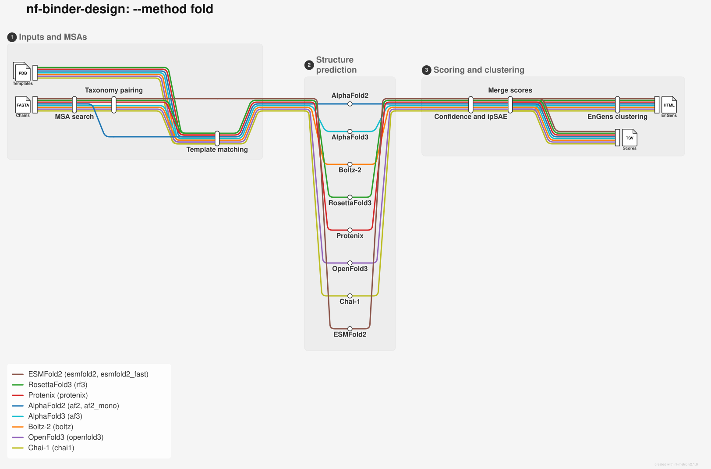

# Fold Workflow

[](../images/fold_metro_map.svg){target="_blank" rel="noopener" title="Open the full-size diagram in a new tab"}

Multi-method structure prediction for monomer **and multimer** FASTA
inputs. Predicts structures with any combination of AlphaFold2, Boltz-2,
RosettaFold3, Protenix, AlphaFold3, OpenFold3, Chai-1 and ESMFold2, sharing one
MSA-generation stage, then (by default) clusters the ensemble with EnGens.

> **AlphaFold3** (`--methods af3`) needs model weights that you download yourself
> under Google DeepMind's terms of use: see [AlphaFold3 weights](#alphafold3-weights).

> **Multimer:** a FASTA with more than one record folds as a protein complex
> (one record = one chain → chain IDs A, B, C, …; homo-oligomers = repeated
> records; up to 26 chains). Each engine gets a taxonomically-paired MSA in its
> native format; see [Multimer complexes](#multimer-complexes) below.

## Overview

Launched via `main.nf` with `--method fold`:

```bash
nextflow run Australian-Protein-Design-Initiative/nf-binder-design \
  --method fold \
  --input 'input/*.fasta' \
  --outdir results \
  --methods af2,boltz,rf3,protenix \
  --msa_method jackhmmer_af2 \
  -profile local
```

From a git clone:

```bash
nextflow run /path/to/nf-binder-design \
  --method fold \
  --input UL119_domain.fasta \
  --outdir results \
  --methods af2,boltz,rf3,protenix \
  --msa_method jackhmmer_af2 \
  -profile slurm,m3
```

Each input FASTA is one prediction unit: a single record folds as a monomer, and
multiple records fold together as one complex (chains A, B, C, …). Shared MSAs
feed all selected predictors; optional MSA subsample and EnGens clustering
produce a conformational ensemble from the combined predictions.

`--n_predictions` sets how many structures each method produces per input,
unset by default. See [Key Parameters](#key-parameters) below for how this maps
onto each engine's sampling and batch size settings.

## Setup

Engine containers, and the weights inside them, are pulled automatically. The
exception is AlphaFold3, whose weights you download yourself (see
[AlphaFold3 weights](#alphafold3-weights)). Local sequence databases are needed
only for `--msa_method jackhmmer_af2`, or for `--msa_method mmseqs2_colabfold`
without `--use_remote_server true`. See [Fold databases](../extra/fold-databases.md)
for download scripts, the expected layout and the defaults on M3.

## Example Usage

Minimal AF2-only run with jackhmmer MSAs:

```bash
nextflow run /path/to/nf-binder-design --method fold \
  --input input/pdl1.fasta \
  --outdir results \
  --methods af2 \
  --msa_method jackhmmer_af2 \
  --af2_db_path /mnt/datasets/alphafold/alphafold_20240229 \
  -profile local
```

Multi-method ensemble (25 structures per method) with ColabFold remote MSA:

```bash
nextflow run /path/to/nf-binder-design --method fold \
  --input UL119_domain.fasta \
  --outdir results \
  --methods af2,boltz,rf3,protenix,openfold3,esmfold2,esmfold2_fast \
  --msa_method mmseqs2_colabfold \
  --use_remote_server true \
  --n_predictions 25 \
  --af2_keep_models all \
  -profile slurm,m3
```

See `examples/fold/run-m3.sh` and `examples/fold/run-local.sh` for complete
HPC / workstation wrappers (including Apptainer bind mounts for AF2 DBs).

## Choosing engines

| Engine | Weights | Multimer pairing | GPU per job | Relative cost |
|--------|---------|-------------------|-------------|----------------|
| **AF2** (`af2`) | Bundled in the container | Native multimer pipeline (requires the 2021 DB snapshot: see [below](#af2-multimer-needs-the-2021-db-snapshot)) | 1 | Low–medium; 5 models/run regardless of `--n_predictions` |
| **AF2 monomer** (`af2_mono`) | Bundled in the container | None (chain-break method) | 1 | Same as AF2; not an independent engine: see [below](#af2_mono-af2-monomer-weights-on-a-complex-chain-break) |
| **Boltz-2** (`boltz`) | Bundled in the container | Taxid-keyed CSV pairing (or its own MSA server with `--use_msa_server`) | 1 | Low |
| **RosettaFold3** (`rf3`) | Bundled in the container | `TaxID=` a3m pairing | 1 | Medium |
| **Protenix** (`protenix`) | Bundled in the container | Species-mnemonic paired/unpaired a3m | 1 | Medium |
| **AlphaFold3** (`af3`) | Downloaded separately: see [AlphaFold3 weights](#alphafold3-weights) | Species-mnemonic pairing rendered from the shared MSA | 1 | Medium–high |
| **OpenFold3** (`openfold3`) | Bundled in the container | Online species pairing from `uniprot_hits` | 1 | Medium; JIT-compiles Triton kernels on first use |
| **Chai-1** (`chai1`) | Bundled in the container | Taxid pairing keys in per-chain MSA parquet files, paired by Chai-1 itself | 1 | Medium |
| **ESMFold2** (`esmfold2`) | Bundled in the container | `key=<taxid>` a3m pairing, done by ESMFold2 itself | 1 | Medium |
| **ESMFold2-Fast** (`esmfold2_fast`) | Bundled in the container | None: single-sequence only without MSA (see [below](#esmfold2)) | 1 | Low |

Every predict job takes one GPU; concurrency across jobs is governed by
`--gpu_devices` (comma-separated device list, or `all`), `--gpu_slots_per_device`
(concurrent tasks per GPU, default 1) and `--gpu_lock_timeout` (seconds a task
waits for a free slot before failing, default 14400). `af2_mono` shares lineage
with AF2 multimer: review the caveats below before including it in a consensus
calculation.

## Multiple Sequence Alignments (MSAs)

All selected predictors share one MSA stage controlled by `--msa_method`.

### Option 1: AlphaFold jackhmmer / HHblits (`jackhmmer_af2`)

Default route. Runs AlphaFold's MSA pipeline against local genetic databases
under `--af2_db_path`, then converts the resulting MSAs to an a3m for
Boltz / RF3 / Protenix. AF2 predict reuses the same features (including
templates) unless MSA subsample rebuilds features from a shallow a3m.

```bash
--msa_method jackhmmer_af2 \
--af2_db_path /path/to/alphafold_dbs \
--af2_db_preset full_dbs
```

Databases used under `--af2_db_path` (paths are fixed relative to that root):

| Database | Role |
|----------|------|
| UniRef90 | jackhmmer |
| MGnify | jackhmmer |
| BFD + UniRef30 | HHblits (`full_dbs`) |
| PDB70 + PDB mmCIF | templates |

The individual paths default to the layout produced by DeepMind's own download
script relative to `--af2_db_path` (e.g. `mgnify/mgy_clusters_2022_05.fa`,
`uniref30/UniRef30_2021_03`); override one with its own
`--af2_uniref30_subpath` / `--af2_mgnify_subpath` / `--af2_uniprot_subpath` /
`--af2_pdb_seqres_subpath` / `--af2_pdb70_subpath` flag when a snapshot uses a
different filename (needed for [AF2 multimer against the 2021
snapshot](#af2-multimer-needs-the-2021-db-snapshot), whose HHblits DB is
`uniclust30` rather than `uniref30`). See
[Fold databases](../extra/fold-databases.md).

### Option 2: ColabFold MMseqs2 (`mmseqs2_colabfold`)

#### Remote server

```bash
--msa_method mmseqs2_colabfold --use_remote_server true
```

Queries the public ColabFold MMseqs2 API (no local DBs). Suitable for small /
occasional runs; for heavy use prefer local databases.

#### Local databases

```bash
--msa_method mmseqs2_colabfold \
--uniref30 /path/to/colabfold_dbs/uniref30 \
--colabfold_envdb /path/to/colabfold_dbs/colabfold_envdb
```

`--uniref30` must contain `uniref30_*` MMseqs2 DB files;
`--colabfold_envdb` must contain `colabfold_envdb*` files (layout produced by
[`scripts/download_colabfold_dbs.sh`](../extra/fold-databases.md#colabfold-mmseqs2-databases)).

> There is no site-wide default ColabFold DB path on M3 yet; use
> `--use_remote_server true` or install local DBs yourself.

### MSA subsample (optional)

CF-random-style shallow random MSAs per predict task:

```bash
--msa_subsample true
# or a custom list, e.g. --msa_subsample '1:2,8:16,64:128'
```

`--msa_subsample true` uses depths `1:2,2:4,...,64:128`.
`--msa_subsample_include_full` (default `true`) also keeps one full-MSA job
(AF2 retains jackhmmer templates on that path). Depths with `max_seq` greater
than or equal to the MSA sequence count are skipped (they would only shuffle
the full MSA). For each depth job (including full), `fold/msa_ids/` lists
`header_line<TAB>id` where `header_line` is the 0-based file line of that
sequence's `>` header in the original a3m (disambiguates duplicate accessions).

## Multimer complexes

A FASTA with more than one record folds as a **protein complex**: each record is
one chain, in file order, assigned chain IDs `A, B, C, …` (up to 26). A
homo-oligomer is expressed as **repeated identical records** (a `count:`
shorthand is not implemented yet). Ligands and nucleic acids are not supported in
this release: protein complexes only.

```bash
nextflow run /path/to/nf-binder-design --method fold \
  --input input/complex.fasta \
  --methods af2,boltz,rf3,protenix \
  --msa_method jackhmmer_af2 \
  -profile slurm,m3
```

### Paired MSAs by prediction engine {#paired-msas-how-each-engine-differs}

For a complex, co-evolutionary pairing across chains provides the interface signal.
Each engine consumes a paired MSA in a different native format, so the fold
workflow searches each chain independently and then renders each engine's format from
one canonical taxonomy parse. When `af2` or `af2_mono` is also selected under
`jackhmmer_af2`, per-chain MSAs come from AF2's multimer search of the complex
rather than a second search of each chain:

| Engine | How it pairs | What the fold workflow feeds it |
|--------|--------------|--------------------------|
| **AF2** | Its own native multimer pipeline (jackhmmer + species pairing) | The whole complex + `--model_preset=multimer` against the 2021 DB snapshot |
| **RF3** | atomworks pairs by numeric `TaxID=<n>` in a3m headers | Per-chain a3m with `TaxID=` annotated headers |
| **Protenix** | Pairs by species *mnemonic* (`_HUMAN`, `_9BETA`) | Per-chain `pairedMsaPath` (mnemonic headers) + `unpairedMsaPath` |
| **AF3** | Pairs by species mnemonic, parsed only from UniProt-style `tr\|ACC\|NAME_SPECIES` headers | Per-chain `pairedMsaPath` re-rendered with `tr\|…_SPECIES` headers + `unpairedMsaPath` (AF3's own data pipeline is never run) |
| **OpenFold3** | Pairs online by species, read from the 4th field of `uniprot_hits` headers | Per-chain directory with `colabfold_main.a3m` (unpaired) + `uniprot_hits.a3m` re-rendered as `tr\|ACC\|ACC_SPECIES/1-N` (pairing only) |
| **Chai-1** | Pairs rows across chains sharing a `pairing_key`, done by Chai-1 itself | One `.aligned.pqt` per unique chain sequence, with `pairing_key = taxid`; rows with no taxonomy are kept as that chain's unpaired rows |
| **Boltz-2** | Pairs rows across chains sharing a taxid `key` | Per-chain `key,sequence` CSV (`key = taxid`) |
| **ESMFold2** | Pairs rows across chains sharing a `key=<taxid>` token, done by ESMFold2 itself | One a3m per chain with `key=<taxid>` headers; unlike the other renders, rows with no taxonomy are kept (laid out block-diagonally) |

RF3 / Protenix / Boltz's rendered per-chain files are published under
`<outdir>/fold/msa/paired/`, and each render logs its paired-row depth per
chain. AF3, OpenFold3, Chai-1 and ESMFold2 render their own pairing input inline
inside their respective predict/input-prep tasks, so their re-rendered a3ms
are not published under `msa/paired/`.

> **Use `--msa_method jackhmmer_af2` for paired multimers.** Only the jackhmmer
> route produces the rich UniProt/UniRef headers (`TaxID=`, `RepID=`,
> `sp|/tr|…_SPECIES`) that taxonomy pairing needs. The ColabFold route emits
> taxonomy-less headers, so under `mmseqs2_colabfold` the chains fold **unpaired**;
> for a ColabFold-style multimer, use `--use_msa_server true` instead (Boltz
> fetches and pairs its own MSA; drop `af2` from `--methods`).

### AF2 multimer needs the 2021 DB snapshot

AF2 multimer loads different weights (`--model_preset=multimer`) and a different
data pipeline that pairs species **internally** against the `uniprot/` all-seqs
DB + `pdb_seqres/` templates. The default `alphafold_20240229` snapshot is
monomer-only (no `uniprot/`), so the fold workflow fails fast if `af2` (or
`af2_mono` under `jackhmmer_af2`) is requested for a multimer without a
`uniprot/`-bearing `--af2_db_path`. Point it at the 2021 snapshot
(`/mnt/datasets/alphafold/alphafold_20211129` on M3), whose HHblits DB is
`uniclust30` rather than `uniref30`: override `--af2_uniref30_subpath` (and
`--af2_mgnify_subpath`, `--af2_uniprot_subpath`, `--af2_pdb_seqres_subpath`)
accordingly. The `alphafold2` container bundles **multimer_v3** model weights
(`params_model_*_multimer_v3.npz`) alongside the monomer/ptm weights, so
`--af2_data_dir` does not need to be overridden for multimer mode: it only
needs pointing at a host `params/` directory if you are running without the
bundled weights. See [`examples/fold-multimer/`](https://github.com/Australian-Protein-Design-Initiative/nf-binder-design/tree/main/examples/fold-multimer)
(`nextflow.m3.config` + `run-m3.sh`) for a working set of overrides.
`--num_multimer_predictions_per_model` (`--af2_num_predictions_per_model`)
applies in multimer mode.

### `af2_mono`: AF2 monomer weights on a complex (chain break)

`--methods af2_mono` folds a complex with the **monomer** weights
(`--af2_monomer_model_preset`, default `monomer_ptm`): the chains are concatenated
into one sequence and separated only by a jump of `--af2_chain_break_offset`
(default 200) in `residue_index`. AF2 clips relative positions at 32, so anything
above that reads as "not covalently connected". The MSA is block diagonal, containing
each chain's own hits, gapped outside that chain's columns. Output is split back into
real chains automatically, renumbered `1..L` per chain, so it feeds ipSAE and
everything else exactly like the other engines.

It reuses the same per-chain MSAs as `af2`; only `features.pkl` differs. You can
run both in one pipeline: their predictions, score TSVs (`tool` column `af2` vs
`af2_mono`) and `fold/predictions/` filenames are kept separate. It works with
either MSA route (`jackhmmer_af2` or `mmseqs2_colabfold`), with `--msa_subsample`,
and with homo-oligomer inputs; under `jackhmmer_af2` a multimer still needs a
`uniprot/`-bearing `--af2_db_path` (same requirement as `af2` itself), because
`af2_mono`'s per-chain MSAs come from AF2's multimer search even though the
predict step then uses the monomer weights.

**Use cases.** AF2-multimer pairs MSA rows across chains by taxonomy. If one chain
has no homologs (such as a de novo designed binder), there is nothing to pair,
so the merged MSA is block diagonal anyway. `af2_mono` carries the same information
without the multimer head, providing a controlled comparison.

**Usage considerations:**

1. **Pair it with `--af2_keep_models best`.** Without an initial guess, monomer
   models frequently do not dock the chains. Ranking by mean pLDDT separates docked
   poses from uncomplexed chains; selecting `all` would inject undocked poses into
   any downstream consensus. The workflow warns if you select `af2_mono` without `best`.
2. **Architecture lineage.** `monomer_ptm` and `multimer` share an architecture
   family and training corpus. Treat it as an evaluation within the AF2 lineage
   rather than an independent predictor alongside Boltz, RF3, or Protenix.

Monomer presets do template search with hhsearch over `pdb70` rather than hmmsearch
over `pdb_seqres`, so `--af2_pdb70_subpath` must resolve under `--af2_db_path`
(this is the one existence check the multimer path never reaches; it is honoured
by the MSA stage as well as predict).

`--msa_subsample` is monomer-only and is rejected for multimer inputs.

## AlphaFold3 weights

The AlphaFold3 container (`ghcr.io/australian-protein-design-initiative/containers/alphafold3:3.0.4`)
does **not** include the model parameters. They are released by Google DeepMind
under the [AlphaFold3 Model Parameters Terms of Use](https://github.com/google-deepmind/alphafold3/blob/main/WEIGHTS_TERMS_OF_USE.md)
and [Prohibited Use Policy](https://github.com/google-deepmind/alphafold3/blob/main/WEIGHTS_PROHIBITED_USE_POLICY.md).
In short, they are for **non-commercial use only**, may **not be shared outside your
organisation**, and AF3 outputs may not be used to train other structure predictors.
Read the terms in full before downloading.

The pipeline looks for the weights in `--af3_model_dir`, which defaults to
`models/alphafold3/` in your copy of the pipeline. That default resolves
relative to the pipeline checkout, so if you launch the pipeline by revision
(`nextflow run Australian-Protein-Design-Initiative/nf-binder-design ...`)
rather than from a local clone, pass `--af3_model_dir` explicitly: the
default would otherwise point inside Nextflow's cached copy of the
pipeline under `~/.nextflow/assets/`. To download the weights there:

```bash
# From a clone of nf-binder-design; prints the terms and asks you to type 'yes'
./models/download_af3_weights.sh

# Or somewhere else (eg a group-shared location within your organisation)
./models/download_af3_weights.sh -o /path/to/af3_weights
# ... then run the pipeline with --af3_model_dir /path/to/af3_weights
```

Or download `af3.bin.zst` manually and put it in a directory of its own. Notes:

- The directory must contain **exactly one** model file (`af3.bin.zst` or
  `af3.bin`). AlphaFold3 reads the compressed `.zst` directly, so you don't need
  to decompress it.
- The pipeline checks the directory before starting and fails early with
  instructions if the weights are missing.
- You don't need any bind-mount configuration. The directory is staged into each
  AlphaFold3 task as `af3_models/`, which Docker, Apptainer and Singularity mount
  automatically, and passed to AF3 as `--model_dir=af3_models`.
- AF3's genetic databases are **not** needed. The pipeline supplies MSAs from its
  shared MSA stage and runs AF3 with `--run_data_pipeline=false`.
- Pre-Ampere GPUs (V100, T4; compute capability 7.x) need a workaround, which
  `--af3_flash_attention auto` (the default) applies: xla flash attention plus
  `XLA_FLAGS=--xla_disable_hlo_passes=custom-kernel-fusion-rewriter`. Ampere or
  newer (A100, H100, L40S) uses triton.
- `--af3_batch_size` sets diffusion samples per job (`--num_diffusion_samples`,
  default 5); `--n_predictions` splits across jobs as for the other diffusion
  engines. `--af3_seeds` sets the base seed (default 1); batch *i* uses
  `seed + i`. `--af3_num_recycles` defaults to 10.
- `--af3_jax_cache_dir /some/shared/dir` keeps JAX compilation results between
  tasks, which saves several minutes per job for repeated input sizes.

### Germinal AF3 parity {#germinal-af3-parity}

Germinal's native AF3 call specifies minimal options
(`germinal/filters/af3.py`): `--model_dir`, `--db_dir`, `--output_dir`, and
`--json_path`. The differences between Germinal's invocation and default pipeline
settings are:

| Setting | Germinal | `fold` / `fold_pulldown` default |
|---|---|---|
| cross-chain pairing | none: `"pairedMsa": ""` on every chain | a paired a3m per chain |
| templates | no `templates` key, so **AF3 searches** `pdb_seqres` + `mmcif_files` on every chain | `"templates": []`, or inlined from `--templates` |
| data pipeline | runs (no `--norun_data_pipeline`) | `--run_data_pipeline=false` |
| seeds | N seeds in one job's `modelSeeds` (3 initial fold, 5 final) | one seed per batch, `seed + i` |
| recycles / samples | AF3 defaults: 10 and 5 | same (`--af3_num_recycles 10`, `--af3_batch_size 5`) |

`-profile af3_germinal_parity` sets the first three together, along with
Germinal's MSA mode and sampling (`conf/af3_germinal_parity.config`):

```bash
nextflow run main.nf --method fold_pulldown \
    --targets targets.fasta --binders binders.fasta \
    --methods af3 \
    -profile af3_germinal_parity \
    --af3_db_dir /mnt/datasets/alphafold3/3.0.0 \
    --af3_model_dir /path/to/af3_weights \
    --af3_seeds '1,2,3,4,5' \
    --create_target_msa true --create_binder_msa false \
    --msa_method mmseqs2_colabfold --use_remote_server true
```

Template search requires the full ~630 GB database collection even when MSAs
are supplied via JSON. AlphaFold3 validates all nine default database paths
before reading input files; an incomplete `--af3_db_dir` causes `FileNotFoundError`
during task execution. The pipeline verifies that all nine paths exist prior
to launch.

Each setting can be configured independently (`--af3_paired_msa false`,
`--af3_templates inline|none|search`, `--af3_run_data_pipeline true`); the profile
simply bundles these options.

!!! note "Differences from native Germinal execution"
    Germinal samples random seeds in `[0, 999999)`. Specify `--af3_seeds` when
    particular seed values are required; for sample matching, the seed count
    is the relevant parameter. Additionally, Germinal selects the lowest-scoring
    sampled structure by `ranking_score` (`af3_structure_select_mode: "worst"`),
    whereas this pipeline scores and preserves all generated structures.

## OpenFold3

OpenFold3 (`--methods openfold3`) runs from
`ghcr.io/australian-protein-design-initiative/containers/openfold3:0.5.0_nv-cuda12_weights`,
which includes the default OpenFold3 checkpoint under `/models/openfold3`, so no
download or weights flag is needed.

- MSAs come from the shared MSA stage (`--use-msa-server false`). Templates are
  used only with `--templates` (see [Templates](#templates)). Each chain's MSA directory holds the shared a3m as
  `colabfold_main.a3m`, and multimers add a species-tagged `uniprot_hits.a3m`
  for cross-chain pairing.
- `--openfold3_batch_size` sets diffusion samples per job
  (`--num-diffusion-samples`); `--n_predictions` splits across jobs as for the
  other diffusion engines.
- OpenFold3 JIT-compiles Triton kernels on first use. By default the cache is stored
  in each task's work directory; `--openfold3_kernel_cache_dir /some/shared/dir`
  persists it across tasks.

## Chai-1

Chai-1 (`--methods chai1`) runs from
`ghcr.io/australian-protein-design-initiative/containers/chai-1:2026-06-30_66c38d1_nv-cuda12_weights`
(chai-lab 0.6.1), which includes the model and ESM2 language-model weights
under `/models/chai`, so no download or weights flag is needed.

- The `chai-lab fold` command does not save the PAE matrix, so the pipeline
  calls Chai-1's Python API through `bin/fold/run_chai1.py`. This lets ipSAE be
  computed for Chai-1 models as for the other engines.
- MSAs come from the shared MSA stage and are written as Chai-1's
  `.aligned.pqt` files; Chai-1's ColabFold MSA server is never used. Hits whose
  header starts with `UniRef` are labelled as `uniref90` (Chai-1 keeps at most
  10,000 of these) and all others as `bfd_uniclust`, as Chai-1 does for its own
  ColabFold MSAs.
- Templates are used only with `--templates` (see [Templates](#templates)).
- `--chai1_batch_size` sets diffusion samples per job; `--n_predictions`
  splits across jobs as for the other diffusion engines.
- `--chai1_num_trunk_recycles` (default 3) and `--chai1_num_diffn_timesteps`
  (default 200) are passed to Chai-1 when set.
- The `ranking_score` column is Chai-1's `aggregate_score` (0.2 × pTM +
  0.8 × ipTM, with a penalty for inter-chain clashes).

## ESMFold2

ESMFold2 provides two engines through the `esm` package (v3.4.1.post1).
Select either or both, e.g. `--methods esmfold2,esmfold2_fast` to compare them:

| Method | Checkpoint | Container | MSA |
|--------|------------|-----------|-----|
| `esmfold2` | `biohub/ESMFold2` | `esmfold2:3.4.1.post1_nv-cuda13_full_weights` | Yes (multimers paired by ESMFold2 itself) |
| `esmfold2_fast` | `biohub/ESMFold2-Fast` | `esmfold2:3.4.1.post1_nv-cuda13_fast_weights` | None: folds from sequence alone |

- Weights (including the ESMC-6B language-model encoder) are baked into each
  container, so weights are not downloaded at run time. `--esmfold2_weights_dir`
  (exported as `HF_HOME`) points both engines at an external HuggingFace cache
  instead.
- `esmfold2_fast` has no MSA encoder, so it never uses or triggers an MSA
  search: on its own it skips the MSA stage entirely, and alongside other
  engines it ignores the MSAs they share. The pipeline logs a warning to that
  effect whenever it is selected.
- `--esmfold2_single_sequence` folds `esmfold2` (the full checkpoint)
  from the sequence alone, skipping its MSA, providing a direct comparison against
  `esmfold2_fast`.
- The `esm` package provides no command-line interface, so the pipeline calls its
  Python API through `bin/fold/run_esmfold2.py`.
- `--esmfold2_kernel_backend` (`fused` default, `cuequivariance`, or `none`):
  `fused` is roughly 3.5x faster and falls back to the reference path
  if Triton is unavailable.
- The options below are shared by both engines (`--esmfold2_msa_max_depth`
  only affects `esmfold2`). `--esmfold2_batch_size` sets diffusion samples per job; `--n_predictions`
  splits across jobs as for the other diffusion engines. `--esmfold2_seeds`
  sets the base seed (default 42); batch *i* uses `seed + i`.
  `--esmfold2_num_loops`, `--esmfold2_num_sampling_steps` and
  `--esmfold2_msa_max_depth` default to the `esm` package defaults (20,
  200, 1024 respectively).
- ESMFold2 reports no ranking score: the `ranking_score` column is blank
  in the score table. Rank on `iptm`, `plddt`, or `ipsae` instead. It
  reports ptm, iptm, per-token pLDDT, a PAE matrix, and a per-chain-pair
  ipTM matrix, and ipSAE is computed accordingly.

## Templates

`--templates` takes known structures (`.pdb` or `.cif`, optionally gzipped) as a
directory or a glob. Files may contain single chains or complete complexes without
requiring a mapping file.

- Every protein chain in each file is aligned to every chain being folded, matching
  AF2's template search behavior against the PDB.
- A template is retained for a chain when its alignment satisfies all cutoffs
  below; the top `--template_max_per_chain` templates by identity × coverage are used.
- Templates inform individual chain conformations only; inter-chain spatial
  arrangements are not transferred from templates.
- Normalised template files and summary reports are published to
  `<outdir>/fold/templates/`. `templates_matched.tsv` records each evaluated
  chain and template pair, including identity, coverage, aligned length, and
  filtering decisions.

### Match cutoffs

| Option | Default | Meaning |
|--------|---------|---------|
| `--template_min_identity` | `0.3` | Identity over the aligned residues |
| `--template_min_coverage` | `0.3` | Fraction of the folded chain the alignment covers |
| `--template_min_aligned` | `40` | Aligned residues required |
| `--template_max_per_chain` | `4` | Templates kept per chain, best first |

```bash
nextflow run main.nf --method fold ... \
    --templates my_structures/ \
    --template_min_identity 0.8 \
    --template_max_per_chain 1
```

- Increase `--template_min_identity` (such as `0.8`) when only near-identical
  structures should be considered, which is standard for known targets.
- `--template_min_coverage` specifies a fraction, meaning short chains require
  fewer residues: 30% of a 60-residue binder corresponds to 18 residues.
  `--template_min_aligned` establishes the minimum threshold so that short
  alignments against unrelated structures are excluded.
- Chains shorter than `--template_min_aligned` require full-length coverage,
  allowing short peptide templates to be utilized without lowering the global threshold.
- Alignments near the threshold should be inspected in `templates_matched.tsv`,
  and `--template_min_identity` adjusted upward when higher stringency is needed.

### How each engine uses them

| Engine | Templates per chain | How they are passed |
|--------|---------------------|---------------------|
| `af2`, `af2_mono` | up to 4, user templates first | Added to the chain's features ahead of any AF2 found itself |
| `af3` | up to `--template_max_per_chain` | Inline mmCIF with an explicit residue mapping |
| `boltz` | up to `--template_max_per_chain` | Pinned to the chain, with an optional distance restraint |
| `chai1` | up to 4 | m8 hit table plus local CIF files, realigned by Chai-1 with kalign |
| `openfold3` | up to `--template_max_per_chain` | CIF files, realigned by OpenFold3 with kalign |
| `protenix` | up to `--template_max_per_chain` | AF3-format JSON, run with `--use_template true` |
| `rf3` | 1 (the best match) | The chain itself, built with the template's coordinates |
| `esmfold2`, `esmfold2_fast` | none | No template input; folds without them, with a warning |

Engine-specific template handling:

- AF2: models accept at most 4 templates; user-supplied templates displace
  templates found during automated search. Only monomer models 1 and 2 use
  templates; all multimer models support them. Shallow `--msa_subsample` jobs fold
  without user templates.
- Boltz-2: Boltz aligns templates directly and uses only the longest gap-free match;
  templates with missing loops contribute a single continuous segment.
  `--boltz_template_force` constrains the chain within `--boltz_template_threshold`
  (default 1.0 Å) of the template. This constraint is disabled by default in
  `--method fold` to guide predictions without over-biasing, and enabled by default
  in `--method fold_pulldown` where individual subunit structures are known.
- Protenix: requires container builds from upstream commit 85767b8 or later.
  Release v2.0.0 cannot parse structure-file templates.
- RosettaFold3: RF3 lacks a dedicated template input parameter. Instead, the chain
  is supplied as a coordinate file containing the target sequence with template
  coordinates mapped onto aligned residues (backbone coordinates only when residues
  differ). Residues lacking template coverage remain unconstrained.
- OpenFold3: the pipeline configures OpenFold3's template directory to point to
  staged files, disabling RCSB downloads.
- Chai-1: matched CIF files are copied to Chai-1's template directory prior to execution,
  preventing RCSB network requests. Chai-1 uses at most 4 templates per chain and
  logs a warning if a template cannot be loaded.

## EnGens clustering

After prediction, EnGens runs by default (UMAP + HDBSCAN) and writes
`results/engens/<id>/clusters.html` plus representative conformations.
With the default `--engens_featurizers default,3di`, the report also encodes
each structure as a [3Di](https://www.biotite-python.org/latest/apidoc/biotite.structure.alphabet.I3DSequence.html)
local-structure string (Foldseek alphabet via biotite), shows pairwise 3Di
identity and per-residue entropy, and runs UMAP/clustering on a 3Di
substitution-matrix embedding alongside EnGens' geometric featurizers.
Sequences and entropy tables are published under
`results/engens/<id>/structural_alphabet/`.

| Flag | Description |
|------|-------------|
| `--skip_engens` | Skip clustering |
| `--engens_clustering` | `hdbscan` (default), `gmm`, `km`, or comma-separated |
| `--engens_featurizers` | `default` (EnGens residue_mindist / torsions), `3di`, `pb` (comma-separated; default: `default,3di`) |
| `--engens_min_structures` | Minimum structures before clustering (default: 3) |
| `--engens_max_clusters` | Upper bound for auto cluster-count search |

To cluster an existing folder of `.cif` / `.pdb` without re-folding, use the
standalone `engens.nf` workflow:

```bash
nextflow run /path/to/nf-binder-design/engens.nf \
  --input results/fold/predictions/ \
  --id UL119_domain \
  --outdir results \
  -profile slurm,m3
```

## Command-line Options

```bash
nextflow run Australian-Protein-Design-Initiative/nf-binder-design --method fold --help
```

### Key Parameters

| Flag | Description |
|------|-------------|
| `--input` | Single FASTA, glob, or directory of FASTA files (required) |
| `--outdir` | Output directory (default: `results`) |
| `--methods` | Comma-separated: `af2`, `af2_mono`, `boltz`, `rf3`, `protenix`, `af3`, `openfold3`, `chai1`, `esmfold2`, `esmfold2_fast` (default: `af2`) |
| `--msa_method` | `jackhmmer_af2` (default) or `mmseqs2_colabfold` |
| `--n_predictions` | Total structures per input, per method (see below) |
| `--msa_subsample` | Off by default; `true` (default depth list) or a custom `max_seq:max_extra_seq` list. Depths with `max_seq >=` MSA size are skipped |
| `--msa_subsample_include_full` | Keep one full-MSA job when subsampling (default: `true`) |
| `--skip_engens` | Skip post-prediction EnGens clustering |
| `--engens_clustering` | `hdbscan` (default), `gmm`, `km`, or comma-separated |
| `--engens_featurizers` | `default,3di` (default); also `pb`; comma-separated |
| `--engens_superpose_method` | Superposition scheme for the geometric featurizers (default: `blosum62`) |

Method-specific flags (`--af2_*`, `--boltz_*`, `--rf3_*`, `--protenix_*`, `--af3_*`, `--openfold3_*`, `--chai1_*`, `--esmfold2_*`) are
documented in `--help`.

**`--n_predictions`** is **unset by default**, in which case each engine falls
back to its own default: Boltz, RF3, Protenix, AF3, OpenFold3, Chai-1 and ESMFold2 each
emit **5** diffusion samples in a single job (Boltz is lifted from its native default of 1
for cross-engine parity), while AF2 does a single run and keeps per
`--af2_keep_models` (default `best` → one structure). Set `--n_predictions N` to
pin every diffusion engine to exactly N, split across jobs by that engine's own
`--*_batch_size` (e.g. `--n_predictions 10 --boltz_batch_size 5` runs Boltz as
two jobs of 5 samples each; leaving `--*_batch_size` unset runs one job of N).
AF2 generates its 5 trained models per execution; `--af2_keep_models` determines
how many executions are required to produce N predictions (`best` keeps the
top-ranked model per run, requiring N runs; `all` keeps all 5 per run, requiring
`ceil(N/5)` runs).

Seeds are unset by default so each engine draws its own random seed (pin
`--af2_random_seed` / `--boltz_seed` / `--rf3_seed` / `--protenix_seeds` /
`--chai1_seeds` for reproducibility; avoid injecting a fresh random seed on every
CLI invocation when using `-resume`). AlphaFold3, OpenFold3, and ESMFold2 require
seed inputs and default to fixed base seeds (`--af3_seeds 1`, `--openfold3_seeds 42`,
`--esmfold2_seeds 42`); batch *i* uses `seed + i`. `--protenix_seeds` and
`--chai1_seeds` use the same convention. Without `--chai1_seeds`, each Chai-1 job
generates its own seed and records it in output filenames.

## Output

Default directory layout under `--outdir` (`params.json` and `logs/` are written
to the outdir root alongside `fold/`, as they are shared across all workflows):

```
results/
├── params.json
├── logs/                     # report/trace/timeline/dag + gpu_trace_<datestamp>.txt
├── fold/
│   ├── msa/<msa_method>/     # shared MSAs + a3m (jackhmmer_af2 or mmseqs2_colabfold)
│   ├── af2/msas/             # AF2-only features.pkl (not under fold/msa/)
│   ├── af2/ … boltz/ … rf3/ … protenix/ … af3/ … openfold3/ … chai1/ … esmfold2/ … esmfold2_fast/    # per-engine predictions + <tool>_fold_scores.tsv
│   ├── predictions/          # flat gather: af2_*, boltz_*, rf3_*, protenix_*, af3_*, openfold3_*, chai1_*, esmfold2_*, esmfold2_fast_* mmCIF
│   ├── fold_scores.tsv       # master score table: one row per generated structure
│   ├── msa_ids/              # when --msa_subsample: header_line<TAB>id (0-based '>' line)
│   └── templates/            # when --templates: templates_matched.tsv + normalised tmpl*.cif
└── engens/<id>/              # clusters.html + representative conformations (HDBSCAN by default)
                              # + structural_alphabet/ (3Di FASTA + entropy when enabled)
```

### Score table (`fold/fold_scores.tsv`)

One row per generated structure across all engines. Each engine also writes a
per-tool table (`fold/<tool>/<tool>_fold_scores.tsv`); the master merges them,
**normalizing column names** for equivalent scores. Provenance columns name the
`tool`, input `id`, `model`/sample index, `batch` (which predict job produced
it) and `msa_depth` (MSA subsample depth, blank unless `--msa_subsample` was
used), the engine-native `original_file`, and the renamed `predictions_file` in
`fold/predictions/` (unique per structure).

| Column | Meaning | AF2 | Boltz | Protenix | RF3 | AF3 | OpenFold3 | Chai-1 | ESMFold2 / ESMFold2-Fast |
|--------|---------|-----|-------|----------|-----|-----|-----------|--------|----------|
| `ranking_score` | engine's overall ranking metric | `ranking_confidence` (0.8×ipTM + 0.2×pTM for multimer presets; mean pLDDT for monomer presets, incl. `af2_mono`) | confidence_score | ranking_score | ranking_score | ranking_score | sample_ranking_score | aggregate_score | – (not reported; rank on `iptm`/`plddt`/`ipsae`) |
| `ptm` / `iptm` | (interface) predicted TM-score | ✓ (pkl) | ✓ | ✓ | ✓ | ✓ | ✓ | ✓ | ✓ |
| `plddt` | mean pLDDT, **rescaled to 0–1** | ✓ | ✓ | ✓ | ✓ | ✓ (mean per-atom) | ✓ | ✓ (per-token) | ✓ (per-token) |
| `pae` / `pde` | overall predicted aligned / distance error | – | pde | pde (`gpde`) | pae, pde | pae (mean) | pae (mean), pde (`gpde`) | pae (mean) | pae (mean) |
| `has_clash` | steric-clash flag | – | – | ✓ | ✓ | ✓ | ✓ | ✓ (inter-chain) | – |
| `ipsae`, `ipsae_d0chn`, `ipsae_d0dom`, `pdockq`, `pdockq2`, `lis` | ipSAE interface metrics (`bin/ipsae.py`) | ✓ (computed) | ipsae only | ✓ (computed) | ✓ (computed) | ✓ (computed) | ✓ (computed) | ✓ (computed) | ✓ (computed) |

Blank where an engine doesn't report a metric. Asymmetric per-chain-pair scores
(e.g. Protenix `chain_pair_iptm`, Boltz `pair_chains_iptm`) are intentionally
omitted; only overall values are reported.

## Related

- Example run directory: [`examples/fold/`](https://github.com/Australian-Protein-Design-Initiative/nf-binder-design/tree/main/examples/fold)
- [Fold databases](../extra/fold-databases.md)
- Standalone EnGens: `engens.nf`
